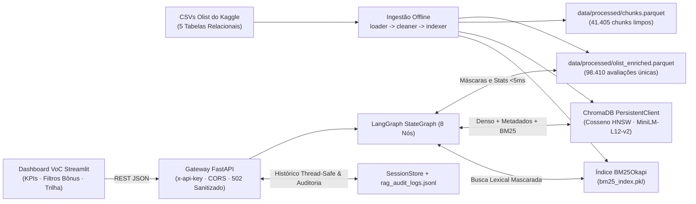
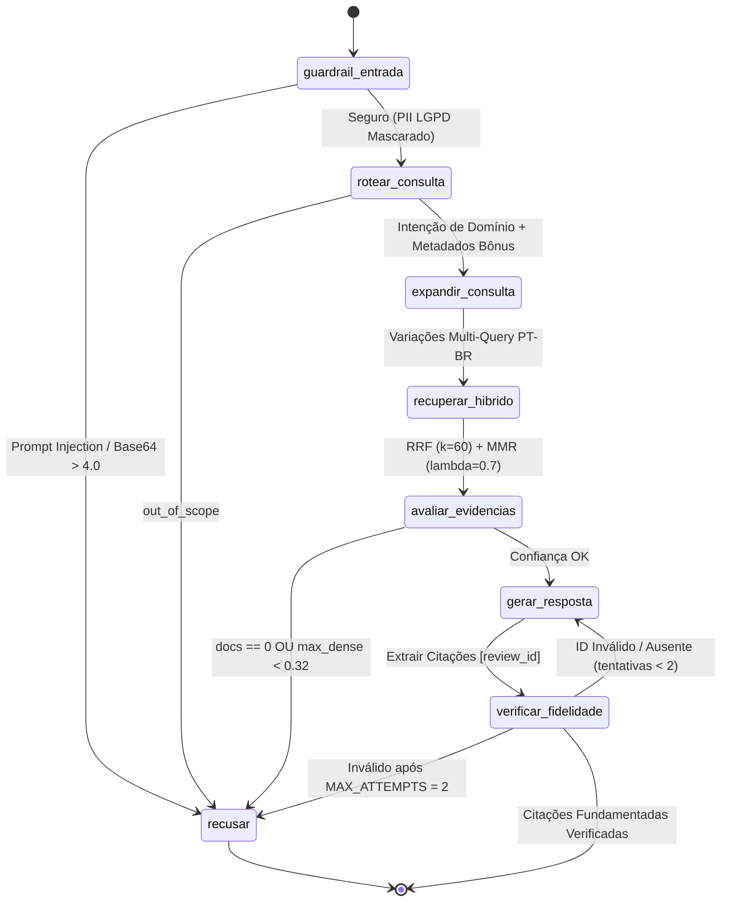
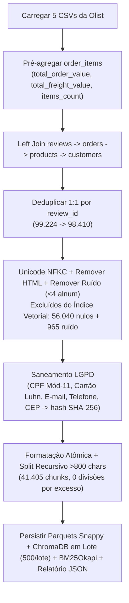
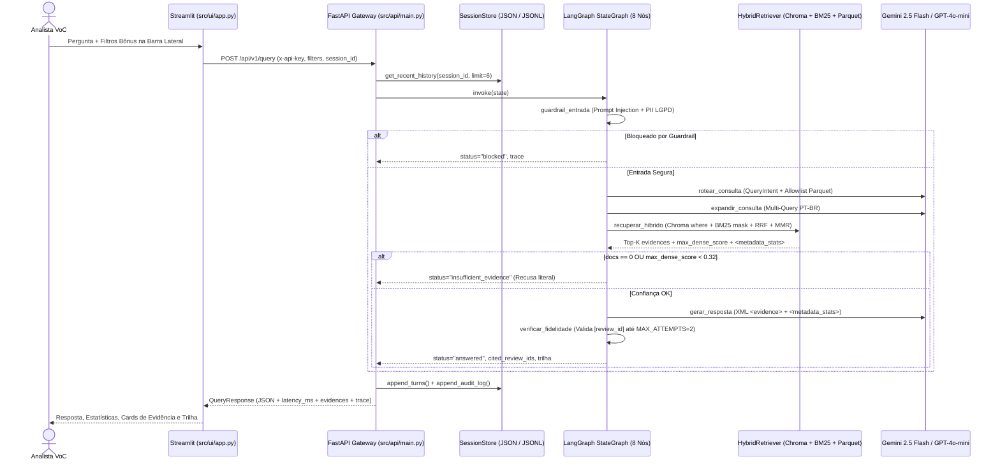

# Olist Voice of Customer (VoC) — Plataforma de RAG Híbrido e Analytics

> **Tech Challenge — Fase 4 (`[IAST]`)**: Plataforma conversacional de Inteligência de Voz do Cliente (VoC) sobre **98.410 pedidos e avaliações únicas do e-commerce brasileiro Olist** (`2016-09` a `2018-10`), projetada com uma **arquitetura padrão de mercado Zero-Docker**: **Apache Parquet** + **ChromaDB** + **BM25Okapi** + **RRF + MMR** + **LangGraph** + **FastAPI** + **Streamlit**.

---

## 1. Problema de Negócio e Solução Executiva

Analisar manualmente quase 100 mil avaliações de clientes em português brasileiro não escala, enquanto uma arquitetura RAG ingênua baseada apenas em vetores falha em duas frentes críticas em analytics corporativo de VoC:
1. **Cegueira Quantitativa**: A busca vetorial não consegue calcular médias exatas, volumes totais ou taxas de atraso em recortes filtrados (por exemplo, *"qual é a nota média e a taxa de entrega atrasada da categoria `moveis_decoracao`?"*).
2. **Alucinação e Riscos de Conformidade**: LLMs sem restrições inventam causas, extrapolam percentuais a partir de 5 trechos recuperados ou expõem dados pessoais (PII — CPF, e-mails, telefones, CEPs, cartões de crédito) presentes nos comentários originais dos clientes.

Este sistema resolve ambos os desafios por meio de uma **arquitetura RAG Híbrida de plano duplo**:
- **Plano Semântico Vetorial e Lexical (`ChromaDB` + `BM25Okapi`)**: 41.405 chunks de avaliações substantivas e não vazias combinados via **Reciprocal Rank Fusion (`RRF`, k=60)** e diversificados com **Maximal Marginal Relevance (`MMR`, lambda=0.7)**.
- **Plano Analítico Quantitativo Vetorizado (`Apache Parquet`)**: 98.410 pedidos/avaliações deduplicados carregados em memória (máscaras booleanas em `< 5 ms`) para injetar estatísticas exatas de coorte em `<metadata_stats>` junto aos blocos textuais `<evidence>`.
- **Orquestração com Estado e Guardrails (`LangGraph` — Grafo de 8 Nós)**: Sanitização de prompt injection (PT/EN) e mascaramento LGPD de PII na entrada, roteamento estruturado com **Bonus Metadata Filters**, gate de confiança por similaridade (`SIMILARITY_THRESHOLD=0.32`), verificação obrigatória de citações `[review_id]` (`MAX_ATTEMPTS=2`) e recusa determinística literal quando não há evidências suficientes.

---

## 2. Arquitetura do Sistema

### 2.1 Arquitetura Ponta a Ponta



### 2.2 Orquestração LangGraph e Máquina de Estados dos Guardrails



### 2.3 Fluxo de Ingestão Offline e Limpeza LGPD



### 2.4 Fluxo de Execução em Tempo de Consulta (Diagrama de Sequência)



### 2.5 Separação por Camadas e Papel do Gateway API

O sistema segue uma separação clara em **5 camadas desacopladas**:

1. **Camada de Ingestão Offline (`src/ingestion/`)**: Executa em batch a união relacional dos 5 CSVs, saneamento textual/LGPD e materialização dupla de índices (`olist_enriched.parquet`, `chunks.parquet`, `chroma_db/`, `bm25_index.pkl` e `ingestion_report.json`).
2. **Camada de Armazenamento & Persistência (`src/storage/`)**: `ParquetAnalyticsStore` mantém os DataFrames colunares Snappy em memória para filtragem vetorial/lexical sub-5 ms e métricas populacionais exatas; `SessionStore` gerencia históricos por sessão (`sessions/*.json`) e auditoria append-only (`rag_audit_logs.jsonl`) sob `threading.Lock` e sanitização contra *path traversal*.
3. **Camada de Recuperação & Orquestração (`src/rag/` + `src/security/`)**: Combina busca densa no ChromaDB, busca lexical mascarada no BM25Okapi, fusão `RRF` (`k=60`) e diversificação `MMR` (`lambda=0.7`) dentro de um grafo LangGraph de 8 nós com failover automático de LLM (`gemini-2.5-flash` -> `gpt-4o-mini`).
4. **Camada de Gateway REST (`src/api/`)**: Expõe contratos Pydantic estritos via FastAPI:
   - `GET /health` — prontidão do serviço e volumes indexados;
   - `GET /api/v1/metadata/filters` — KPIs globais e allowlists dinâmicas (`valid_categories`, `valid_order_statuses`, janela temporal);
   - `POST /api/v1/query` — aceita tanto JSON (`QueryRequest`) quanto texto puro (`Content-Type: text/plain`), executa Gemini + busca híbrida e retorna resposta, evidências, `trace_id`, `latency_ms` e `trilha` (com `save_result: true` opcional para persistir em `results/saved_queries.jsonl`);
   - `POST /api/v1/query/text` e `GET /api/v1/query?question=...` — atalhos dedicados para enviar perguntas em texto simples diretamente para o Gemini processar e pesquisar nos dados;
   - `GET /api/v1/sessions/{session_id}/history` — histórico persistido da sessão;
   - `GET /api/v1/results/overview` (`?format=json|markdown`) — consulta o panorama final consolidado em `results/` (`rag_final_overview.json` / `.md`);
   - `POST /api/v1/results/overview/refresh` — regenera o panorama consolidado em `results/` a partir do índice Parquet/RAG ativo e métricas de avaliação;
   - `GET /api/v1/results/queries` — lista os snapshots de consultas salvos em `results/saved_queries.jsonl`.
5. **Camada de Apresentação (`src/ui/`)**: Dashboard Streamlit focado exclusivamente em UX analítica (KPIs executivos, controles de Metadados Bônus, presets demo, Cards de Evidência com destaque para IDs citados e aba de auditoria da `trilha`).

**Por que manter uma API FastAPI em vez de acoplar tudo diretamente no Streamlit?**
- **Inicialização única de objetos pesados (`lifespan`)**: O Streamlit reexecuta `src/ui/app.py` de cima a baixo a cada interação do usuário na interface. Carregar `ParquetAnalyticsStore`, o modelo `SentenceTransformer`, o cliente persistente do `ChromaDB` e o índice `BM25Okapi` (41.405 documentos) no `lifespan` do FastAPI garante carga única em memória na inicialização do servidor.
- **Fronteira de segurança e isolamento de segredos**: As chaves `GOOGLE_API_KEY` e `OPENAI_API_KEY` permanecem exclusivamente no backend, protegidas por autenticação opcional `x-api-key`, `CORSMiddleware` e sanitização de exceções (`mascarar_segredos()` -> `HTTP 502` sem vazamento de tokens ou stack traces).
- **Validação de contrato e consistência transacional**: O FastAPI impõe validação Pydantic antes de acionar o grafo (`question` entre `3–1000` caracteres, `score` `1–5`, datas `YYYY-MM`, `top_k` `3–25`) e centraliza a gravação thread-safe de histórico e logs LGPD em um único ponto.
- **Desacoplamento e testabilidade**: Qualquer outro cliente (React/Next.js, scripts de BI, notebooks ou testes automatizados via `TestClient`) consome o mesmo motor RAG por HTTP REST sem alterar uma única linha da orquestração LangGraph.

---

## 3. Seleção de Dados, Esquema e Auditoria Observada do Corpus

### 3.1 Tabelas Relacionais Utilizadas vs. Omitidas

O pipeline de ingestão (`src/ingestion/loader.py`) integra **5 datasets centrais da Olist no Kaggle** (`olistbr/brazilian-ecommerce`):
1. `olist_order_reviews_dataset.csv` — notas dos clientes (`1–5`), títulos e mensagens de avaliação (granularidade base, deduplicada 1:1 por `review_id`).
2. `olist_orders_dataset.csv` — `order_status` (`delivered`, `canceled`, `shipped`, etc.), datas de compra, previsão de entrega e entrega efetiva ao cliente (base para `is_late_delivery` e `delivery_delay_days`).
3. `olist_order_items_dataset.csv` — pré-agregado por `order_id` (`items_count`, `total_order_value`, `total_freight_value` e `product_id` principal) **antes** do join para evitar multiplicação de linhas.
4. `olist_products_dataset.csv` — `product_category_name` canônico em português (valores ausentes normalizados para `"nao_informada"`).
5. `olist_customers_dataset.csv` — `customer_state` (`SP`, `RJ`, etc.) para contexto regional de entrega.

**Por que `olist_order_payments_dataset.csv` e outros arquivos auxiliares são omitidos:**
- Um pedido na Olist pode ser dividido em múltiplas linhas de pagamento (cartão + vale-presente + parcelamentos). Fazer join com `olist_order_payments_dataset.csv` sem agregação separada gera risco de duplicação de valores ou fan-out de linhas, enquanto `order_items` já fornece exatamente `price` e `freight_value` itemizados por pedido.
- `olist_geolocation_dataset.csv` (+1 milhão de coordenadas por prefixo de CEP), `olist_sellers_dataset.csv` e `product_category_name_translation.csv` são omitidos porque consultas e embeddings operam nativamente em português brasileiro (`paraphrase-multilingual-MiniLM-L12-v2`).

### 3.2 Métricas Reais Verificadas de Auditoria (`data/processed/ingestion_report.json`)

A execução de `python -m src.ingestion.pipeline --raw-dir data/raw --rebuild` sobre o dataset do Kaggle gerou exatamente estes números verificados:

| Etapa / Métrica de Auditoria | Contagem Exata Observada | Observações |
| --- | ---: | --- |
| `total_raw_reviews` | **99.224** | Linhas brutas em `olist_order_reviews_dataset.csv` |
| `duplicates_removed` | **814** | Linhas duplicadas de `review_id` removidas após ordenação |
| `deduplicated_reviews` | **98.410** | Avaliações únicas persistidas em `olist_enriched.parquet` |
| `null_text_dropped` | **56.040** | Avaliações sem título nem mensagem (mantidas nos KPIs do Parquet, excluídas do índice vetorial) |
| `noise_dropped` | **965** | Textos apenas com pontuação/emojis com `< 4` caracteres alfanuméricos |
| `valid_text_reviews` | **41.405** | Avaliações limpas com texto substantivo |
| `total_chunks` | **41.405** | Indexados em `chunks.parquet`, `ChromaDB` e `BM25Okapi` |
| `total_pii_masked` | **1** | Entidades PII validadas e mascaradas no dataset (LGPD) |
| `split_long_reviews` | **0** | Coerência atômica 1-avaliação-1-chunk (fallback para `> 800` caracteres pronto) |

**KPIs Globais do Dataset Verificados ao Vivo via `GET /api/v1/metadata/filters`:**
- Total de Avaliações Deduplicadas: **98.410** (`41.405` com texto, `57.005` apenas com nota)
- Nota Média Global: **4,09 / 5,0**
- Taxa Global de Atraso na Entrega: **7,76%**
- Categorias de Produto Distintas: **74**
- Status de Pedido (`8` valores): `approved`, `canceled`, `created`, `delivered`, `invoiced`, `processing`, `shipped`, `unavailable`
- Janela Temporal de Compras: **`2016-09` a `2018-10`**

---

## 4. Decisões Técnicas: Chunking, Armazenamento Duplo e Metadados Bônus

### 4.1 Chunking Atômico de Avaliações
Cada avaliação substantiva (`<= 800` caracteres) é armazenada como um **único chunk atômico** enriquecido com contexto estruturado (`Nota 1/5 | Categoria moveis_decoracao | Entrega: Atraso +10 dias | Status: delivered | Periodo: 2018-03`). Avaliações acima de `800` caracteres utilizam o fallback `RecursiveCharacterTextSplitter(chunk_size=600, chunk_overlap=80)`. O chunking atômico evita fragmentar comentários curtos de clientes, elimina perda de contexto no meio de frases e mantém um vínculo limpo 1:1 entre `chunk_id` e `review_id` para verificação estrita de citações.

### 4.2 Armazenamento Híbrido Zero-Docker (`Parquet` + `ChromaDB` + `BM25Okapi`)
- **Apache Parquet (`pyarrow`, Snappy)**: Carregado em memória uma única vez na inicialização da API (`olist_enriched.parquet` ~7,2 MB, `chunks.parquet` ~8,8 MB), viabilizando máscaras booleanas vetorizadas em `< 5 ms` alinhadas 1:1 aos índices do corpus `BM25Okapi`, além de KPIs populacionais exatos (`<metadata_stats>`) — eliminando a sobrecarga operacional de PostgreSQL/Docker para analytics offline.
- **ChromaDB (`PersistentClient`, `hnsw:space="cosine"`)**: Armazena embeddings L2-normalizados de 384 dimensões do modelo `sentence-transformers/paraphrase-multilingual-MiniLM-L12-v2` com atributos de metadados (`review_score`, `product_category`, `order_status`, `is_late_delivery` e `purchase_ym_int` numérico para filtros de intervalo `$gte`/`$lte`).
- **BM25Okapi (`rank_bm25`)**: Tokens normalizados em português sem acentuação (`tokenizar_lexical`), mascarados diretamente pelas máscaras booleanas do Parquet antes do `argsort` para que documentos fora do recorte nunca vazem para os candidatos lexicais (com saída rápida em coortes vazios).

### 4.3 Filtragem por Metadados Bônus (UI + Roteador + Índices Duplos)
Todas as 7 dimensões de metadados funcionam de forma integrada a partir dos **Controles da Barra Lateral da UI** (que têm prioridade) e da **Extração Estruturada de Intenção via LLM** (`QueryIntent`), validadas contra listas permitidas do Parquet (`valid_categories` via correspondência exata + `difflib` `>= 0.75` + isolamento `"__nonexistent__"`; `valid_order_statuses` via correspondência exata):
- `score_min` / `score_max` (`1..5`)
- `product_category` (`74` categorias da Olist)
- `order_status` (`delivered`, `canceled`, `shipped`, etc.)
- `is_late_delivery` (`true` / `false`)
- `date_start` / `date_end` (`YYYY-MM` traduzido para `purchase_ym_int` no ChromaDB e limites de string no Parquet)

---

## 5. Guardrails de Segurança e Privacidade LGPD

Implementados em [guardrails.py](file:///c:/Users/thiag/Documents/projetos/tech-challenge-4/src/security/guardrails.py) e aplicados em `guardrail_entrada`, na limpeza de ingestão e nos handlers de erro do FastAPI:
- **Mascaramento Determinístico de PII (LGPD)**:
  - **CPF**: Regex + validação de dígitos verificadores Módulo-11 (números inválidos como `12345678900` são preservados; CPFs válidos viram `[CPF_OCULTADO]`).
  - **Cartões de Pagamento**: Verificação de 13–19 dígitos com checksum de Luhn (`[CARTAO_OCULTADO]`).
  - **E-mail, Telefone, CEP**: Mascarados para `[EMAIL_OCULTADO]`, `[TELEFONE_OCULTADO]`, `[CEP_OCULTADO]` com hashes SHA-256 com salt de 12 caracteres registrados para auditoria (`rag_audit_logs.jsonl`).
- **Bloqueio de Prompt Injection e Payloads Suspeitos**:
  - Detecta frases de sobrescrita de instruções em português e inglês (`ignore previous instructions`, `desconsidere regras`, `system prompt`, `modo DAN`, `sem restricoes`, spoofing de tags XML `<evidence>`/`<system>`, comandos shell) além de strings Base64/codificadas (`>= 40` caracteres, entropia de Shannon `> 4.0`).
- **Isolamento por Tags XML e Limpeza de Segredos**:
  - Comentários de avaliações recuperados recebem escape XML dentro de tags `<evidence>` e são tratados estritamente como dados não confiáveis.
  - Exceções inesperadas em `POST /api/v1/query` passam por `mascarar_segredos()` (`AIza...`, `sk-...`, `Bearer ...`, `key=...`) antes de retornar `HTTP 502` sanitizado.

---

## 6. Resultados de Avaliação: Ablação de Recuperação e Benchmark

### 6.1 Ablação em 4 Estratégias de Recuperação (Corpus Real Olist de 41.405 Chunks)

Executada via `python -m tests.eval_suite` em 8 tarefas representativas de VoC da Olist (`G01`–`G08` cobrindo atrasos na entrega, `moveis_decoracao` com defeito, `informatica_acessorios` com avaria, elogios 5 estrelas com entrega rápida, pedidos `canceled`, itens faltantes, qualidade de `cama_mesa_banho` e recorte do 1º semestre de 2018; Recall@K calculado como `acertos_no_top_k / min(K, |conjunto_relevante|)`):

| Estratégia de Recuperação | Casos | Recall@5 | Recall@10 | MRR | Latência Média (ms) |
| --- | ---: | ---: | ---: | ---: | ---: |
| **Apenas BM25** | 8 | 0,5000 | 0,4375 | 0,5012 | 57,5 ms |
| **Apenas Vetor Denso** (`MiniLM-L12-v2`) | 8 | 0,3250 | 0,3500 | 0,5188 | 253,8 ms |
| **Híbrido (`Denso + BM25 + RRF`)** | 8 | 0,3750 | 0,4250 | 0,6031 | 106,8 ms |
| **Pipeline Completo (`Multi-Query + Filtro de Metadados + RRF + MMR`)** | **8** | **0,9000** | **0,8500** | **1,0000** | **318,3 ms** |

**Principais Conclusões:**
- A fusão Denso + BM25 via RRF eleva o `MRR` (`0,5188 -> 0,6031`) sobre as baselines isoladas.
- A adição de **Multi-Query em PT-BR + Filtragem por Metadados Bônus + diversidade MMR** eleva o `Recall@5` de `0,3750` para **`0,9000` (+140% relativo)** e o `MRR` para **`1,0000`**, mantendo a latência total de recuperação em torno de **318 ms** em CPU.

### 6.2 Exemplos Reais de Evidências Recuperadas e Guardrails

- **Evidências Reais Recuperadas (Coorte de Entregas Atrasadas — `is_late_delivery=True, score<=2`)**:
  - Coorte Parquet (`<metadata_stats>`): `4.126` avaliações (`2.872` com texto), nota média `1,14 / 5,0`, `100,0%` de entregas atrasadas.
  - Maior similaridade densa `0,7125` (`>= 0,32` de limiar):
    - `[6a24fdb69a1596a14f8ebe8386855576]` (`utilidades_domesticas`, `atraso=+4d`, `2018-02`): *"Não é a primeira vez de atraso na entrega, quando consegue falar a atendente ainda pede um prazo de dois dias..."*
    - `[bc99e8911baf06b4d1d126d9f23baeb3]` (`cama_mesa_banho`, `atraso=+9d`, `2018-03`): *"Atraso na entrega — Quero saber porque tanto atraso na minha encomenda, porque deram previsão de entrega para o dia 23/4 até hoje nada"*
- **Evidências Reais Recuperadas (`moveis_decoracao`, `score<=2`)**:
  - Coorte Parquet (`<metadata_stats>`): `1.020` avaliações (`733` com texto), nota média `1,23 / 5,0`, `27,5%` de entregas atrasadas.
  - Maior similaridade densa `0,7162`:
    - `[eada60766110d984171b1a231c1e3600]` (`score=1`, `2017-03`): *"produto com defeito"*
    - `[92fc88d99622e08c0975b8649358ff0e]` (`score=2`, `2018-02`): *"Achei de péssima qualidade"*
- **Exemplo de Recorte Vazio / Recusa por Baixa Confiança (`Q13`: `moveis_decoracao` em `2016-01..2016-03`)**:
  - `docs=0`, `max_dense=0.0 < 0.32` -> recusa literal:
    > *"Não encontrei evidências suficientes nas avaliações recuperadas para responder a esta pergunta com segurança."*
- **Exemplo ao Vivo de Bloqueio de Prompt Injection no FastAPI (`POST /api/v1/query`)**:
  - Trilha observada ao vivo: `status="blocked"`, `latency_ms=4`, `trace=["guardrail_entrada:blocked (pattern:ignore_previous_instructions)", "recusar:blocked"]`.

> **Nota sobre Avaliação com LLM (`tests/eval_suite.py`)**: No ambiente de verificação offline sem chaves externas de API, `14/14` verificações determinísticas de segurança, PII e recuperação no corpus real (`Q01`–`Q08`, `Q10`–`Q15`) passaram, enquanto `Q09` (`out_of_scope`) e `Q16` (follow-up multi-turno) foram ignorados porque `GOOGLE_API_KEY` / `OPENAI_API_KEY` não estavam configuradas. Todos os caminhos de roteamento, retry/reparo e recusa do grafo LangGraph de 8 nós também são cobertos pelo `pytest` em [test_graph_and_api.py](file:///c:/Users/thiag/Documents/projetos/tech-challenge-4/tests/test_graph_and_api.py) com Runnables determinísticos.

---

## 7. Estrutura do Repositório

```text
tech-challenge-4/
├── data/
│   ├── raw/                        # Arquivos CSV da Olist no Kaggle (ignorados no git)
│   └── processed/                  # Parquets, ChromaDB, pickle BM25, relatórios, sessões (ignorados no git)
├── results/                        # Visão final consolidada (rag_final_overview.json/.md) e saved_queries.jsonl
├── openspec/changes/olist-voc-rag/ # Proposta OpenSpec, design, delta specs e tarefas
├── src/
│   ├── config.py                   # Pydantic BaseSettings e caminhos/limiares centralizados
│   ├── api/
│   │   ├── main.py                 # Lifespan FastAPI, auth x-api-key, CORS, endpoints REST
│   │   └── schemas.py              # Contratos Pydantic da API
│   ├── ingestion/
│   │   ├── loader.py               # Carregador de 5 CSVs, pré-agregação de itens, join 1:1 de reviews
│   │   ├── cleaner.py              # NFKC, filtro de ruído, limpeza LGPD de PII, chunks atômicos/split
│   │   ├── indexer.py              # Parquet Snappy, upsert em lotes no ChromaDB, pickle BM25
│   │   └── pipeline.py             # CLI de entrada (--raw-dir, --rebuild)
│   ├── rag/
│   │   ├── state.py                # QueryIntent, RetrievedEvidence, RAGState
│   │   ├── prompts.py              # Prompts de Roteador, Multi-Query, Síntese Ancorada e Reparo
│   │   ├── router.py               # Extrator de intenção + Metadados Bônus validados por allowlist
│   │   ├── expander.py             # Gerador multi-query em PT-BR
│   │   ├── retriever.py            # HybridRetriever (Chroma + BM25 mascarado + RRF + MMR)
│   │   └── graph.py                # LangGraph StateGraph (8 nós) + LLM resiliente Gemini/OpenAI
│   ├── security/
│   │   └── guardrails.py           # Mascaramento CPF/Luhn/PII, detecção de injection/entropia, scrub de segredos
│   ├── storage/
│   │   ├── parquet_store.py        # Máscaras booleanas <5ms & <metadata_stats> vetorizado
│   │   ├── results_store.py        # Gerador de panorama consolidado e snapshots em results/
│   │   └── session_store.py        # JSON de sessão thread-safe + rag_audit_logs.jsonl
│   └── ui/
│       └── app.py                  # Streamlit: barra de KPIs, barra lateral Bônus, Cards de Evidência e Trilha
├── tests/
│   ├── eval_suite.py               # Ablação em 4 estratégias + benchmark Q01-Q16
│   ├── test_cleaner.py             # Testes unitários de ingestão, deduplicação, ruído e chunking
│   ├── test_graph_and_api.py       # Testes de integração LangGraph (8 nós) + auth/erros FastAPI
│   ├── test_guardrails.py          # Testes de PII LGPD, injection, entropia e scrub de segredos
│   └── test_retriever.py           # Testes unitários de máscara Parquet, RRF, MMR e `where` Chroma
├── .dockerignore                   # Exclusões de build Docker (mantém data/ e results/ em volumes locais)
├── .env.example                    # Modelo de variáveis de ambiente
├── Dockerfile                      # Imagem Python 3.12-slim + PyTorch CPU para API, UI e ingestão
├── docker-compose.yml              # Orquestração API + UI + perfil ingest com bind mounts locais
├── pyproject.toml                  # Dependências e configuração Ruff/Pytest (Python >= 3.12)
└── README.md
```

---

## 8. Configuração e Como Executar (Local ou via Docker)

### 8.1 Pré-requisitos e Instalação do Ambiente

- **Python `>= 3.12`** instalado e acessível no PATH.
- Acesso à internet apenas para download inicial do dataset Olist, do modelo `sentence-transformers/paraphrase-multilingual-MiniLM-L12-v2` (cacheado localmente após a primeira execução) e chamadas ao provedor de LLM.
- **Não requer Docker**, banco externo ou serviços em container.

```powershell
# 1. Criar e ativar ambiente virtual Python >= 3.12 (Windows PowerShell)
python -m venv .venv
.\.venv\Scripts\Activate.ps1

# Equivalente Linux/macOS:
# python3 -m venv .venv && source .venv/bin/activate

# 2. Atualizar pip e instalar pacote + dependências de desenvolvimento
python -m pip install --upgrade pip
pip install -e ".[dev]"

# 3. Criar arquivo de configuração local a partir do template
Copy-Item .env.example .env   # Linux/macOS: cp .env.example .env
```

### 8.2 Variáveis de Ambiente e Configuração (`.env`)

A classe `Settings` (`src/config.py`) carrega automaticamente as variáveis definidas em `.env`:

| Variável | Padrão | Obrigatória | Descrição |
| --- | --- | :---: | --- |
| `GOOGLE_API_KEY` | `""` | Sim* | Chave da API Gemini para o modelo principal (`gemini-2.5-flash`). |
| `OPENAI_API_KEY` | `""` | Não* | Chave da OpenAI para fallback automático (`gpt-4o-mini`). *Ao menos uma entre `GOOGLE_API_KEY` ou `OPENAI_API_KEY` é necessária para síntese LLM ao vivo. |
| `GOOGLE_CHAT_MODEL` | `gemini-2.5-flash` | Não | Modelo Gemini utilizado pelo roteador, expansor e síntese. |
| `OPENAI_CHAT_MODEL` | `gpt-4o-mini` | Não | Modelo OpenAI usado no failover resiliente. |
| `EMBEDDING_MODEL` | `sentence-transformers/paraphrase-multilingual-MiniLM-L12-v2` | Não | Modelo de embeddings multilíngue usado na indexação e busca densa. |
| `SIMILARITY_THRESHOLD` | `0.32` | Não | Similaridade cosseno mínima exigida para responder sem recusa. |
| `RRF_K` | `60` | Não | Constante de suavização da fusão Reciprocal Rank Fusion (`RRF`). |
| `MMR_LAMBDA` | `0.7` | Não | Balanço relevância vs. diversidade no `MMR` (`0.0` = diversidade máxima, `1.0` = relevância pura). |
| `DEFAULT_TOP_K` | `12` | Não | Quantidade padrão de evidências retornadas por consulta (`3` a `25`). |
| `DATA_RAW_DIR` | `data/raw` | Não | Diretório dos CSVs brutos do Kaggle. |
| `DATA_PROCESSED_DIR` | `data/processed` | Não | Diretório de saída para Parquets, ChromaDB, pickle BM25, sessões e logs. |
| `RESULTS_DIR` | `results` | Não | Diretório onde são salvos o panorama final do RAG (`rag_final_overview.*`) e snapshots de consultas. |
| `RAG_API_KEY` | `""` | Não | Token opcional exigido no header `x-api-key`. Se preenchido, exporte também no terminal do Streamlit. |
| `CORS_ORIGENS` | `http://localhost:8501,http://localhost:3000` | Não | Lista separada por vírgula de origens permitidas no CORS do FastAPI. |
| `DEBUG_ERROS` | `0` | Não | Use `1` apenas em desenvolvimento para exibir detalhes mascarados em erros `HTTP 502`. |
| `API_BASE_URL` | `http://127.0.0.1:8000` | Não | URL base da API FastAPI consumida pelo frontend Streamlit. |

Exemplo mínimo de `.env` para execução local:

```env
GOOGLE_API_KEY="sua_chave_gemini_aqui"
OPENAI_API_KEY=""
GOOGLE_CHAT_MODEL="gemini-3.5-flash-lite"
OPENAI_CHAT_MODEL="gpt-4o-mini"
SIMILARITY_THRESHOLD="0.32"
RAG_API_KEY=""
API_BASE_URL="http://127.0.0.1:8000"
```

### 8.3 Download do Dataset e Construção dos Índices

1. Baixe o dataset `olistbr/brazilian-ecommerce` do Kaggle e extraia os CSVs em `data/raw/`:

```powershell
# Windows PowerShell
Invoke-WebRequest -Uri "https://www.kaggle.com/api/v1/datasets/download/olistbr/brazilian-ecommerce" -OutFile "data/raw/olist.zip" -MaximumRedirection 5
tar -xf data/raw/olist.zip -C data/raw
Remove-Item data/raw/olist.zip

# Equivalente Linux/macOS:
# curl -L -o data/raw/olist.zip "https://www.kaggle.com/api/v1/datasets/download/olistbr/brazilian-ecommerce"
# unzip -o data/raw/olist.zip -d data/raw && rm data/raw/olist.zip
```

2. Confirme que os 5 CSVs obrigatórios estão em `data/raw/`:
   - `olist_order_reviews_dataset.csv`
   - `olist_orders_dataset.csv`
   - `olist_order_items_dataset.csv`
   - `olist_products_dataset.csv`
   - `olist_customers_dataset.csv`

3. Execute o pipeline offline de ingestão, saneamento LGPD e indexação dupla (**~6–7 min em CPU** para 41.405 chunks: ~30s para leitura, limpeza e Parquets + ~6 min para embeddings no ChromaDB e índice BM25; `--rebuild` recria a coleção ChromaDB do zero):

```powershell
python -m src.ingestion.pipeline --raw-dir data/raw --rebuild
```

Ao concluir, os seguintes artefatos estarão disponíveis em `data/processed/`:
- `olist_enriched.parquet`, `chunks.parquet`, `chroma_db/`, `bm25_index.pkl` e `ingestion_report.json`.

### 8.4 Subir Backend FastAPI e Interface Streamlit

Abra **dois terminais** com a `.venv` ativada:

**Terminal 1 — API RAG FastAPI (`http://127.0.0.1:8000/docs`):**
```powershell
uvicorn src.api.main:app --host 127.0.0.1 --port 8000
```

Validação rápida da API, perguntas em texto livre para o Gemini e interação com `results/`:
```powershell
# Healthcheck
Invoke-RestMethod -Uri "http://127.0.0.1:8000/health"

# Enviar pergunta em texto simples (GET ou POST text/plain) para o Gemini pesquisar nos dados
Invoke-RestMethod -Uri "http://127.0.0.1:8000/api/v1/query?question=Quais+os+principais+motivos+de+atraso%3F"
Invoke-RestMethod -Method Post -Uri "http://127.0.0.1:8000/api/v1/query/text?save_result=true" -ContentType "text/plain; charset=utf-8" -Body "O que os clientes reclamam em moveis_decoracao?"

# Consultar visão final consolidada em results/ (JSON ou Markdown)
Invoke-RestMethod -Uri "http://127.0.0.1:8000/api/v1/results/overview"
Invoke-RestMethod -Uri "http://127.0.0.1:8000/api/v1/results/overview?format=markdown"

# Regenerar os arquivos de panorama em results/ a partir do índice ativo
Invoke-RestMethod -Method Post -Uri "http://127.0.0.1:8000/api/v1/results/overview/refresh"

# Listar consultas salvas em results/saved_queries.jsonl (envie "save_result": true no POST /api/v1/query)
Invoke-RestMethod -Uri "http://127.0.0.1:8000/api/v1/results/queries"
```

**Terminal 2 — Dashboard VoC Streamlit (`http://localhost:8501`):**
```powershell
# Opcional: se você definiu RAG_API_KEY no .env, defina-a também no ambiente do Streamlit:
# $env:RAG_API_KEY="sua_chave"        # PowerShell
# export RAG_API_KEY="sua_chave"      # Linux/macOS

streamlit run src/ui/app.py
```

Acesse `http://localhost:8501` no navegador. A barra superior exibirá os KPIs do Parquet e a barra lateral habilitará os filtros de **Bonus Metadata** (`review_score`, `product_category`, `order_status`, período `YYYY-MM`, `is_late_delivery` e `top_k`).

### 8.5 Comandos de Verificação, Linting e Benchmark

```powershell
# Testes unitários e de integração (16 testes)
pytest -v

# Linter
ruff check src tests

# Ablação de 4 estratégias + benchmark Q01-Q16 (use --with-llm quando GOOGLE_API_KEY/OPENAI_API_KEY estiver definida)
python -m tests.eval_suite --with-llm
```

### 8.6 Execução via Docker e Docker Compose (com Persistência Local em `results/`)

Se preferir executar a aplicação em containers com **Docker Desktop / Docker Engine**, o projeto inclui [Dockerfile](file:///c:/Users/thiag/Documents/projetos/tech-challenge-4/Dockerfile) e [docker-compose.yml](file:///c:/Users/thiag/Documents/projetos/tech-challenge-4/docker-compose.yml) com **bind mounts locais**:

- `./data:/app/data` — mantém os CSVs brutos (`data/raw/`), Parquets, ChromaDB, BM25 e sessões/logs no host local;
- `./results:/app/results` — garante que **todos os arquivos gerados ou atualizados pela API (`rag_final_overview.json`, `rag_final_overview.md` e `saved_queries.jsonl`) sejam gravados diretamente na pasta local `./results` da sua máquina, e não dentro do container**;
- `hf_cache:/root/.cache/huggingface` — volume nomeado para reutilizar os pesos do `MiniLM-L12-v2` entre reinicializações sem baixá-los novamente.

1. Certifique-se de ter o arquivo `.env` criado e preenchido na raiz do repositório (`Copy-Item .env.example .env`) com sua `GOOGLE_API_KEY`.
2. *(Opcional — pule este passo se `data/processed/` já estiver populada localmente)* Baixe os CSVs da Olist em `data/raw/` (seção 8.3) e execute a ingestão em segundo plano (`-d` para não travar o terminal; adicione `--build` na primeira execução se ainda não tiver construído a imagem):

```powershell
docker compose --profile ingest run -d --rm --build ingest

# Acompanhar o progresso do container de ingestão sem travar o terminal:
docker ps --filter "name=ingest"
docker logs --tail=30 <container_id>
```

> **Tempo estimado da ingestão (`ingest`)**: **~6 a 7 minutos em CPU** para os 41.405 chunks (~30 segundos para leitura dos CSVs, limpeza LGPD e geração dos Parquets + ~6 minutos para encoding e upsert no ChromaDB + BM25). Na primeira execução via Docker, considere também o tempo inicial de build da imagem (`--build`, síncrono antes de liberar o terminal) e do download único dos pesos do `MiniLM-L12-v2` para o volume `hf_cache`. Ao finalizar, o container encerra e é removido automaticamente (`--rm`).

3. Construa a imagem e suba os serviços `api` (`8000`) e `ui` (`8501`) em modo detached (`-d`, sem prender o terminal):

```powershell
docker compose up -d --build
```

4. Verifique o status dos containers (`docker compose ps`) até a API ficar `healthy` e acesse:
   - **Streamlit Dashboard**: `http://localhost:8501` (conecta internamente na API via `http://api:8000`)
   - **Swagger / OpenAPI**: `http://localhost:8000/docs`

5. Validação rápida e persistência em `./results` na máquina local:

```powershell
# Ver status e últimos logs sem travar o terminal (remova --tail para seguir em tempo real com -f)
docker compose ps
docker compose logs --tail=50 api ui

# Atualizar os relatórios finais em ./results localmente via API containerizada
Invoke-RestMethod -Method Post -Uri "http://localhost:8000/api/v1/results/overview/refresh"

# Enviar pergunta em texto livre e salvar snapshot em ./results/saved_queries.jsonl
Invoke-RestMethod -Method Post -Uri "http://localhost:8000/api/v1/query/text?save_result=true" -ContentType "text/plain; charset=utf-8" -Body "Quais as principais reclamacoes sobre atrasos?"

# Encerrar containers (dados e arquivos em ./data e ./results permanecem salvos no disco local)
docker compose down
```

---

## 9. Referência Completa da API (Endpoints e Parâmetros)

Com o servidor FastAPI ativo em `http://127.0.0.1:8000`, a documentação interativa **Swagger UI** fica disponível em `http://127.0.0.1:8000/docs` (e **ReDoc** em `/redoc`).

### 9.1 Autenticação e Códigos de Resposta

- **Header opcional `x-api-key`**: obrigatório em todas as rotas `/api/v1/*` apenas quando `RAG_API_KEY` estiver definida no `.env` (`/health` permanece aberta para *readiness checks*).
- **Códigos HTTP**:
  - `200 OK`: operação executada com sucesso.
  - `401 Unauthorized`: header `x-api-key` ausente ou inválido.
  - `422 Unprocessable Entity`: violação de validação Pydantic (ex.: `question` fora de `3–1000` caracteres, `score` fora de `1–5`, data fora do padrão `YYYY-MM`).
  - `502 Bad Gateway`: erro interno/provedor LLM sanitizado por `mascarar_segredos()` (nenhuma chave ou token vaza na resposta).

### 9.2 Visão Geral dos Endpoints

| Método | Rota | Auth (`x-api-key`) | Finalidade |
| --- | --- | :---: | --- |
| `GET` | `/health` | Não | Status da API e contagem de chunks, avaliações, categorias e status indexados |
| `GET` | `/api/v1/metadata/filters` | Opcional | KPIs globais do corpus Parquet e listas válidas de filtros (`valid_categories`, `valid_order_statuses`, `score_range`) |
| `POST` | `/api/v1/query` | Opcional | Consulta RAG principal aceitando `application/json` (`QueryRequest`) **ou** texto puro (`text/plain`) |
| `POST` | `/api/v1/query/text` | Opcional | Atalho dedicado para pergunta em texto puro (`Content-Type: text/plain`) |
| `GET` | `/api/v1/query` | Opcional | Atalho via URL query string (`?question=...`) para perguntas em texto simples |
| `GET` | `/api/v1/sessions/{session_id}/history` | Opcional | Retorna o histórico completo salvo para uma sessão |
| `GET` | `/api/v1/results/overview` | Opcional | Retorna o panorama final consolidado salvo em `results/` (`json` ou `markdown`) |
| `POST` | `/api/v1/results/overview/refresh` | Opcional | Recalcula e atualiza `results/rag_final_overview.json` e `.md` a partir dos índices ativos |
| `GET` | `/api/v1/results/queries` | Opcional | Lista snapshots de respostas salvos em `results/saved_queries.jsonl` |

### 9.3 Detalhamento de Parâmetros por Endpoint

#### `GET /health`
- **Parâmetros**: nenhum.
- **Retorno (`200`)**: `status`, `index_chunks`, `total_reviews`, `categories`, `order_statuses`.

#### `GET /api/v1/metadata/filters`
- **Parâmetros**: nenhum.
- **Retorno (`200`)**: `total_reviews`, `reviews_with_text`, `reviews_without_text`, `avg_review_score`, `late_delivery_pct`, `categories_count`, `order_statuses_count`, `min_month`, `max_month`, `valid_categories`, `valid_order_statuses`, `score_range` (`[1, 5]`).

#### `POST /api/v1/query` *(JSON ou `text/plain`)*
- **Quando enviado como `application/json` (`QueryRequest`)**:

| Campo | Tipo | Obrigatório | Padrão | Validação / Descrição |
| --- | --- | :---: | --- | --- |
| `question` | `string` | **Sim** | — | Pergunta do usuário (`3` a `1000` caracteres). |
| `session_id` | `string` | Não | `"default"` | Identificador da sessão (`1` a `64` chars, sanitizado contra *path traversal*). |
| `filters` | `MetadataFiltersInput \| null` | Não | `null` | Filtros explícitos de **Bonus Metadata** (têm prioridade sobre o roteador LLM). |
| `top_k` | `integer` | Não | `12` | Quantidade máxima de evidências retornadas (`3` a `25`). |
| `save_result` | `boolean` | Não | `false` | Se `true` (e não bloqueado por guardrail), salva snapshot em `results/saved_queries.jsonl`. |

- **Campos de `filters` (`MetadataFiltersInput`)**:

| Campo | Tipo | Validação / Descrição |
| --- | --- | --- |
| `score_min` | `integer \| null` | Nota mínima (`1` a `5`). |
| `score_max` | `integer \| null` | Nota máxima (`1` a `5`). |
| `product_category` | `string \| null` | Categoria Olist em snake_case (ex.: `"moveis_decoracao"`). |
| `order_status` | `string \| null` | Status do pedido (ex.: `"delivered"`, `"canceled"`, `"shipped"`). |
| `is_late_delivery` | `boolean \| null` | `true` apenas entregas atrasadas, `false` apenas no prazo. |
| `date_start` | `string \| null` | Mês inicial no formato `^\d{4}-\d{2}$` (ex.: `"2018-01"`). |
| `date_end` | `string \| null` | Mês final no formato `^\d{4}-\d{2}$` (ex.: `"2018-06"`). |

- **Quando enviado como `text/plain`**: o corpo bruto UTF-8 é usado diretamente como `question`, aceitando `session_id`, `top_k` e `save_result` via *query params* na URL.

- **Exemplo JSON**:
```json
{
  "question": "Quais as principais reclamações sobre entrega em moveis_decoracao?",
  "session_id": "analise-01",
  "top_k": 10,
  "save_result": true,
  "filters": {
    "score_max": 2,
    "product_category": "moveis_decoracao",
    "order_status": "delivered",
    "is_late_delivery": true,
    "date_start": "2018-01",
    "date_end": "2018-06"
  }
}
```

- **Estrutura da Resposta (`QueryResponse`)**:
  - `trace_id`, `status` (`"answered" | "insufficient_evidence" | "out_of_scope" | "blocked"`), `answer`, `applied_filters`, `aggregate_stats`, `evidences` (`rank`, `review_id`, `order_id`, `review_score`, `product_category`, `order_status`, `is_late_delivery`, `delivery_delay_days`, `purchase_year_month`, `rrf_score`, `dense_score`, `comment`), `cited_review_ids`, `trace`, `latency_ms`.

#### `POST /api/v1/query/text` *(atalho `text/plain`)*
- **Body**: string pura em `Content-Type: text/plain` (`3` a `1000` caracteres).
- **Query Params**: `session_id` (padrão `"default"`, `1–64`), `top_k` (padrão `12`, `3–25`), `save_result` (padrão `false`).
- **Retorno**: mesmo contrato `QueryResponse`.

#### `GET /api/v1/query` *(atalho URL)*
- **Query Params**:
  - `question` (**obrigatório**, `3` a `1000` caracteres)
  - `session_id` (opcional, padrão `"default"`, `1–64`)
  - `top_k` (opcional, padrão `12`, `3–25`)
  - `save_result` (opcional, padrão `false`)
- **Retorno**: mesmo contrato `QueryResponse`.

#### `GET /api/v1/sessions/{session_id}/history`
- **Path Param**: `session_id` (`string`).
- **Retorno (`200`)**: `{"session_id": "...", "messages": [{"role": "human" | "ai", "content": "...", "timestamp": "..."}]}`.

#### `GET /api/v1/results/overview`
- **Query Param**: `format` (`"json"` ou `"markdown"`, padrão `"json"`).
- **Retorno (`200`)**: JSON completo de [rag_final_overview.json](file:///c:/Users/thiag/Documents/projetos/tech-challenge-4/results/rag_final_overview.json) ou texto `text/markdown` de [rag_final_overview.md](file:///c:/Users/thiag/Documents/projetos/tech-challenge-4/results/rag_final_overview.md).

#### `POST /api/v1/results/overview/refresh`
- **Parâmetros**: nenhum.
- **Retorno (`200`)**: objeto JSON consolidado atualizado após regenerar ambos os arquivos em `results/`.

#### `GET /api/v1/results/queries`
- **Query Param**: `limit` (`integer`, `1` a `100`, padrão `20`).
- **Retorno (`200`)**: `{"count": <int>, "items": [...]}` ordenado do snapshot mais recente para o mais antigo.

---

## 10. Roteiro de Apresentação em Vídeo — Tech Challenge (<= 7 min)

| Segmento | Tempo | Foco da Demonstração ao Vivo |
| --- | --- | --- |
| **1. Problema e Arquitetura** | `00:00–01:15` | Motivação de negócio (98,4 mil avaliações VoC da Olist), arquitetura Zero-Docker Parquet + ChromaDB + BM25 + LangGraph |
| **2. Preparação de Dados e Auditoria** | `01:15–02:15` | Justificativa do join de 5 tabelas (omissão de `payments`), filtragem de `ingestion_report.json` e mascaramento LGPD |
| **3. Recuperação Híbrida e Ablação** | `02:15–03:30` | Ganhos de Multi-Query + RRF + MMR (`Recall@5` `0,375 -> 0,900`, `MRR` `1,000`) |
| **4. UI ao Vivo e Metadados Bônus** | `03:30–05:15` | Barra de KPIs, filtragem por `order_status=canceled`, categoria, nota, período, `<metadata_stats>` e Cards de Evidência |
| **5. Segurança, Recusa e Trilha** | `05:15–06:45` | Bloqueio de prompt injection (`blocked`), recusa em coorte vazio (`SIMILARITY_THRESHOLD=0.32`) e inspeção da `trilha` |
