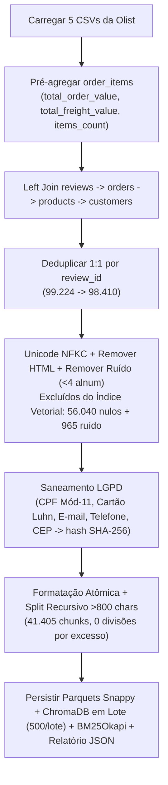
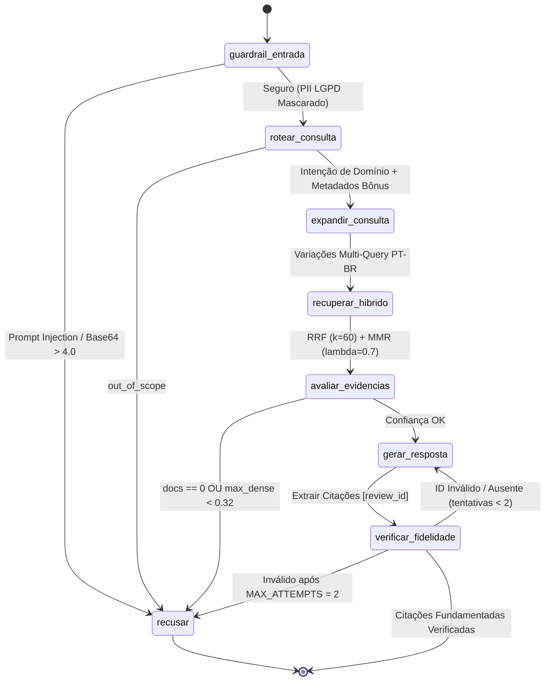

# Olist Voice of Customer (VoC) — Plataforma de RAG Híbrido e Analytics

> **Tech Challenge — Fase 4 (`[IAST]`)**: Plataforma conversacional de Inteligência de Voz do Cliente (VoC) sobre **98.410 pedidos e avaliações únicas do e-commerce brasileiro Olist** (`2016-09` a `2018-10`), projetada com arquitetura híbrida de **Apache Parquet** + **ChromaDB** + **BM25Okapi** + **RRF + MMR** + **LangGraph** + **FastAPI** + **Interface** (execução local ou containerizada via Docker).

---

## 1. Contexto

Analisar manualmente quase 100 mil avaliações de clientes em português brasileiro não escala, enquanto uma arquitetura RAG ingênua baseada apenas em vetores falha em duas frentes críticas em analytics corporativo de Voz do Cliente (VoC):

1. **Cegueira Quantitativa**: A busca vetorial não consegue calcular médias exatas, volumes totais ou taxas de atraso em recortes filtrados (por exemplo, *"qual é a nota média e a taxa de entrega atrasada da categoria `moveis_decoracao`?"*).
2. **Alucinação e Riscos de Conformidade (LGPD)**: LLMs sem restrições inventam causas, extrapolam percentuais a partir de poucos trechos recuperados ou expõem dados pessoais (PII — CPF, e-mails, telefones, CEPs, cartões de crédito) presentes nos comentários originais dos clientes.

---

## 2. Objetivo Analítico

Construir uma **plataforma de RAG Híbrido de plano duplo** capaz de responder perguntas exploratórias e analíticas sobre a experiência dos clientes da Olist com **precisão estatística populacional**, **rastreabilidade por citação (`[review_id]`)** e **conformidade LGPD**:

- **Plano Semântico Vetorial e Lexical (`ChromaDB` + `BM25Okapi`)**: 41.405 chunks de avaliações substantivas e não vazias combinados via **Reciprocal Rank Fusion (`RRF`, k=60)** e diversificados com **Maximal Marginal Relevance (`MMR`, lambda=0.7)**.
- **Plano Analítico Quantitativo Vetorizado (`Apache Parquet`)**: 98.410 pedidos/avaliações deduplicados carregados em memória (máscaras booleanas em `< 5 ms`) para injetar estatísticas exatas de coorte em `<metadata_stats>` junto aos blocos textuais `<evidence>`.
- **Orquestração com Estado e Guardrails (`LangGraph` — Grafo de 8 Nós)**: Sanitização de prompt injection (PT/EN) e mascaramento LGPD de PII na entrada, roteamento estruturado com **Bonus Metadata Filters**, gate de confiança por similaridade (`SIMILARITY_THRESHOLD=0.32`), verificação obrigatória de citações `[review_id]` (`MAX_ATTEMPTS=2`) e recusa determinística literal quando não há evidências suficientes.

---

## 3. Descrição da base utilizada

### 3.1 Tabelas Relacionais Utilizadas vs. Omitidas

O pipeline de ingestão (`src/ingestion/loader.py`) integra **5 datasets centrais da Olist no Kaggle** (`olistbr/brazilian-ecommerce`):

1. `olist_order_reviews_dataset.csv` — notas dos clientes (`1–5`), títulos e mensagens de avaliação (granularidade base, deduplicada 1:1 por `review_id`).
2. `olist_orders_dataset.csv` — `order_status` (`delivered`, `canceled`, `shipped`, etc.), datas de compra, previsão de entrega e entrega efetiva ao cliente (base para `is_late_delivery` e `delivery_delay_days`).
3. `olist_order_items_dataset.csv` — pré-agregado por `order_id` (`items_count`, `total_order_value`, `total_freight_value` e `product_id` principal) **antes** do join para evitar multiplicação de linhas.
4. `olist_products_dataset.csv` — `product_category_name` canônico em português (valores ausentes normalizados para `"nao_informada"`).
5. `olist_customers_dataset.csv` — `customer_state` (`SP`, `RJ`, etc.) para contexto regional de entrega.

**Por que `olist_order_payments_dataset.csv` e outros arquivos auxiliares são omitidos:**
- Um pedido na Olist pode ser dividido em múltiplas linhas de pagamento (cartão + vale-presente + parcelamentos). Fazer join direto com `olist_order_payments_dataset.csv` sem agregação separada gera risco de duplicação de valores ou *fan-out* de linhas, enquanto `order_items` já fornece exatamente `price` e `freight_value` itemizados por pedido.
- `olist_geolocation_dataset.csv` (+1 milhão de coordenadas por prefixo de CEP), `olist_sellers_dataset.csv` e `product_category_name_translation.csv` são omitidos porque consultas e embeddings operam nativamente em português brasileiro (`paraphrase-multilingual-MiniLM-L12-v2`).

### 3.2 Perfil Global do Corpus (`GET /api/v1/metadata/filters`)

- **Total de Avaliações Deduplicadas**: **98.410** (`41.405` com texto substantivo, `57.005` apenas com nota)
- **Nota Média Global**: **4,09 / 5,0**
- **Taxa Global de Atraso na Entrega**: **7,76%**
- **Categorias de Produto Distintas**: **74**
- **Status de Pedido (`8` valores)**: `approved`, `canceled`, `created`, `delivered`, `invoiced`, `processing`, `shipped`, `unavailable`
- **Janela Temporal de Compras**: **`2016-09` a `2018-10`**

---

## 4. Estrutura de pasta do repositório

```text
tech-challenge-4/
├── data/
│   ├── raw/                        # Arquivos CSV da Olist no Kaggle (ignorados no git)
│   └── processed/                  # Parquets, ChromaDB, pickle BM25, relatórios, sessões (ignorados no git)
├── docs/                           # Documentação complementar, apresentação e roteiro de fala
├── results/                        # Visão final consolidada (rag_final_overview.json/.md) e saved_queries.jsonl
├── openspec/changes/olist-voc-rag/ # Proposta OpenSpec, design, delta specs e tarefas
├── src/
│   ├── config.py                   # Pydantic BaseSettings e caminhos/limiares centralizados
│   ├── api/
│   │   ├── main.py                 # Lifespan FastAPI, auth x-api-key, CORS, endpoints REST
│   │   └── schemas.py              # Contratos Pydantic da API
│   ├── ingestion/
│   │   ├── loader.py               # Carregador de 5 CSVs, pré-agregação de itens, join 1:1 de reviews
│   │   ├── cleaner.py              # NFKC, filtro de ruído, limpeza LGPD de PII, chunks atômicos/split
│   │   ├── indexer.py              # Parquet Snappy, upsert em lotes no ChromaDB, pickle BM25
│   │   └── pipeline.py             # CLI de entrada (--raw-dir, --rebuild)
│   ├── rag/
│   │   ├── state.py                # QueryIntent, RetrievedEvidence, RAGState
│   │   ├── prompts.py              # Prompts de Roteador, Multi-Query, Síntese Ancorada e Reparo
│   │   ├── router.py               # Extrator de intenção + Metadados Bônus validados por allowlist
│   │   ├── expander.py             # Gerador multi-query em PT-BR
│   │   ├── retriever.py            # HybridRetriever (Chroma + BM25 mascarado + RRF + MMR)
│   │   └── graph.py                # LangGraph StateGraph (8 nós) + LLM resiliente Gemini/OpenAI
│   ├── security/
│   │   └── guardrails.py           # Mascaramento CPF/Luhn/PII, detecção de injection/entropia, scrub de segredos
│   ├── storage/
│   │   ├── parquet_store.py        # Máscaras booleanas <5ms & <metadata_stats> vetorizado
│   │   ├── results_store.py        # Gerador de panorama consolidado e snapshots em results/
│   │   └── session_store.py        # JSON de sessão thread-safe + rag_audit_logs.jsonl
│   └── ui/
│       └── app.py                  # Interface: barra de KPIs, barra lateral Bônus, Cards de Evidência e Trilha
├── tests/
│   ├── eval_suite.py               # Ablação em 4 estratégias + benchmark Q01-Q16
│   ├── test_cleaner.py             # Testes unitários de ingestão, deduplicação, ruído e chunking
│   ├── test_graph_and_api.py       # Testes de integração LangGraph (8 nós) + auth/erros FastAPI
│   ├── test_guardrails.py          # Testes de PII LGPD, injection, entropia e scrub de segredos
│   └── test_retriever.py           # Testes unitários de máscara Parquet, RRF, MMR e `where` Chroma
├── .dockerignore                   # Exclusões de build Docker (mantém data/ e results/ em volumes locais)
├── .env.example                    # Modelo de variáveis de ambiente
├── Dockerfile                      # Imagem Python 3.12-slim + PyTorch CPU para API, UI e ingestão
├── docker-compose.yml              # Orquestração API + UI + perfil ingest com bind mounts locais
├── pyproject.toml                  # Dependências e configuração Ruff/Pytest (Python >= 3.12)
└── README.md
```

---

## 5. Etapas e RAG

### 5.1 Arquitetura Ponta a Ponta


### 5.2 Etapa 1 — Ingestão Offline e Limpeza LGPD



- **Chunking Atômico (`<= 800` chars)**: Cada avaliação substantiva é armazenada como um único chunk enriquecido com contexto estruturado (`Nota 1/5 | Categoria moveis_decoracao | Entrega: Atraso +10 dias | Status: delivered | Periodo: 2018-03`), preservando vínculo 1:1 entre `chunk_id` e `review_id`. Textos acima de `800` chars utilizam `RecursiveCharacterTextSplitter(chunk_size=600, chunk_overlap=80)`.
- **Armazenamento Duplo (`Parquet` + `ChromaDB` + `BM25Okapi`)**:
  - `ParquetAnalyticsStore` mantém os DataFrames Snappy em memória para máscaras booleanas sub-5 ms e KPIs populacionais exatos (`<metadata_stats>`).
  - `ChromaDB` armazena embeddings L2-normalizados de 384 dimensões (`sentence-transformers/paraphrase-multilingual-MiniLM-L12-v2`) com atributos de metadados para `$gte`/`$lte`.
  - `BM25Okapi` aplica máscaras booleanas do Parquet antes do `argsort` para evitar vazamento de documentos fora do recorte.

### 5.3 Etapa 2 — Orquestração LangGraph (8 Nós) e Fluxo de Consulta




### 5.4 Metadados Bônus, Guardrails LGPD e Desacoplamento API

- **Filtragem por Metadados Bônus (7 Dimensões)**: `score_min`, `score_max` (`1..5`), `product_category` (`74` categorias via allowlist + `difflib >= 0.75`), `order_status` (`8` valores), `is_late_delivery` (`true`/`false`), `date_start` e `date_end` (`YYYY-MM`). Controles da barra lateral da UI têm prioridade sobre a extração automática do roteador LLM.
- **Guardrails de Segurança ([guardrails.py](file:///c:/Users/thiag/Documents/projetos/tech-challenge-4/src/security/guardrails.py))**:
  - Mascaramento determinístico de PII (CPF Módulo-11, cartões Luhn 13–19 dígitos, e-mail, telefone, CEP) com hash SHA-256 com salt em `rag_audit_logs.jsonl`.
  - Bloqueio de prompt injection PT/EN e strings Base64 de alta entropia (`> 4.0`).
  - Isolamento de comentários em tags XML `<evidence>` e sanitização de erros (`mascarar_segredos()` -> `HTTP 502`).
- **Gateway FastAPI Desacoplado (`src/api/`)**: Garante carga única em memória (`lifespan`) do Parquet, `SentenceTransformer`, `ChromaDB` e `BM25Okapi`, isolamento das chaves de API no backend, validação Pydantic estrita e failover automático de LLM (`gemini-2.5-flash` -> `gpt-4o-mini`).

### 5.5 Justificativa das Tecnologias Utilizadas (Fase 4 & Tech Challenge)

As escolhas tecnológicas traduzem diretamente os conteúdos da **Fase 4** (*Deep Learning*, *Processamento de Linguagem Natural*, *IA Generativa* e *LangChain para aplicações de LLM*) e os critérios de engenharia do **`[IAST] - Tech Challenge - Fase 4.pdf`**:

| Tecnologia / Padrão | Por que foi escolhida | Alinhamento com a Fase 4 & Tech Challenge |
| --- | --- | --- |
| **`paraphrase-multilingual-MiniLM-L12-v2`** (`sentence-transformers`) | Embeddings densos de 384d com suporte nativo ao português brasileiro, baixo custo em CPU e boa precisão semântica sem depender de API externa na indexação. | **NLP (Aula 04)** + **IA Gen (Aula 02)** + **DL (Aula 06 — Transformers)**: representação vetorial e criação de embeddings exigida na *Construção da Base de Conhecimento*. |
| **`ChromaDB` + `BM25Okapi` (`rank_bm25`) + RRF + MMR** | O `ChromaDB` oferece filtragem nativa por metadados (`where` com `$gte`/`$lte`) — vantagem decisiva sobre o `FAISS` para o *Desafio Adicional de Metadados*; o `BM25Okapi` preserva termos exatos (ex.: *Correios*, SKU, categorias) e `RRF + MMR` equilibra relevância e diversidade. | **IA Gen (Aula 02 — RAG)** + **LangChain (Aula 02)**: recuperação híbrida, construção de contexto e *Desafio Adicional: Metadados e Exploração Contextual*. |
| **`Apache Parquet` (`pyarrow` / Snappy)** | Armazenamento colunar em memória com máscaras booleanas `< 5 ms` para estatísticas populacionais exatas (`<metadata_stats>`), eliminando a *cegueira quantitativa* do RAG puro sem exigir banco SQL externo. | **Requisitos do Desafio (Seções 1 e 3)**: tratamento de valores ausentes (`56.040` nulos mantidos nos KPIs) e respostas quantitativamente consistentes. |
| **`LangGraph` (`StateGraph` 8 nós) + `Pydantic`** | Permite fluxos cíclicos determinísticos: roteamento por intenção, gate de similaridade (`0.32`), loop de reparo de citações `[review_id]` (`MAX_ATTEMPTS=2`) e recusa literal quando faltam evidências. | **LangChain (Aulas 04–05)** + **IA Gen (Aulas 03–04)**: *Respostas Fundamentadas em Evidências* e *Tratamento de Perguntas sem Evidências Suficientes / Fora de Escopo*. |
| **`Gemini 2.5 Flash` + failover `GPT-4o-mini`** | Baixa latência e janela ampla para síntese ancorada em XML (`<evidence>` + `<metadata_stats>`), com fallback automático entre provedores para resiliência da API. | **LangChain (Aulas 01–03)** + **IA Gen (Aula 03 — Prompt)**: geração fundamentada com isolamento de contexto e saída estruturada. |
| **Guardrails LGPD & Prompt Injection (`src/security/`)** | Mascaramento determinístico de PII (CPF Mód-11, Luhn, e-mail, telefone, CEP) e bloqueio de *prompt injection* / alta entropia protegem dados reais de clientes antes do índice e do LLM. | **IA Gen (Aula 06 — Ética e Segurança)** + **NLP (Aula 02 — Limpeza/Regex)**: privacidade, conformidade e robustez contra ataques em produção. |
| **`FastAPI` + `Interface` + `Docker`** | Separa carga única de modelos em memória e segredos no backend (`FastAPI`) da camada interativa de analytics (`Interface`), com ambiente reproduzível em containers (`Docker Compose`). | **DL (Aula 08 — MLOps/Deploy)** + **LangChain (Aula 04 — FastAPI)** + **Entregáveis do Desafio**: reprodutibilidade, clareza arquitetural e demonstração executiva. |

---

## 6. Métricas

### 6.1 Métricas de Auditoria da Ingestão (`data/processed/ingestion_report.json`)

| Etapa / Métrica de Auditoria | Contagem Exata Observada | Observações |
| --- | ---: | --- |
| `total_raw_reviews` | **99.224** | Linhas brutas em `olist_order_reviews_dataset.csv` |
| `duplicates_removed` | **814** | Linhas duplicadas de `review_id` removidas após ordenação |
| `deduplicated_reviews` | **98.410** | Avaliações únicas persistidas em `olist_enriched.parquet` |
| `null_text_dropped` | **56.040** | Avaliações sem título nem mensagem (mantidas nos KPIs do Parquet, excluídas do índice vetorial) |
| `noise_dropped` | **965** | Textos apenas com pontuação/emojis com `< 4` caracteres alfanuméricos |
| `valid_text_reviews` | **41.405** | Avaliações limpas com texto substantivo |
| `total_chunks` | **41.405** | Indexados em `chunks.parquet`, `ChromaDB` e `BM25Okapi` |
| `total_pii_masked` | **1** | Entidades PII validadas e mascaradas no dataset (LGPD) |
| `split_long_reviews` | **0** | Coerência atômica 1-avaliação-1-chunk (fallback para `> 800` caracteres pronto) |

### 6.2 Ablação de Recuperação Híbrida (`python -m tests.eval_suite`)

Executada sobre o corpus real de **41.405 chunks** em 8 tarefas representativas de VoC (`G01`–`G08` cobrindo atrasos na entrega, `moveis_decoracao` com defeito, `informatica_acessorios` com avaria, elogios 5 estrelas, pedidos `canceled`, itens faltantes, qualidade de `cama_mesa_banho` e recorte do 1º semestre de 2018):

| Estratégia de Recuperação | Casos | Recall@5 | Recall@10 | MRR | Latência Média (ms) |
| --- | ---: | ---: | ---: | ---: | ---: |
| **Apenas BM25** | 8 | 0,5000 | 0,4375 | 0,5012 | 57,5 ms |
| **Apenas Vetor Denso** (`MiniLM-L12-v2`) | 8 | 0,3250 | 0,3500 | 0,5188 | 253,8 ms |
| **Híbrido (`Denso + BM25 + RRF`)** | 8 | 0,3750 | 0,4250 | 0,6031 | 106,8 ms |
| **Pipeline Completo (`Multi-Query + Filtro de Metadados + RRF + MMR`)** | **8** | **0,9000** | **0,8500** | **1,0000** | **318,3 ms** |

- A fusão **Denso + BM25 via RRF** eleva o `MRR` (`0,5188 -> 0,6031`) sobre as baselines isoladas.
- A adição de **Multi-Query em PT-BR + Filtragem por Metadados Bônus + MMR** eleva o `Recall@5` de `0,3750` para **`0,9000` (+140% relativo)** e o `MRR` para **`1,0000`**, mantendo latência média de **318,3 ms** em CPU.
- **Suite de Verificação**: `14/14` verificações determinísticas de segurança, PII e recuperação (`Q01`–`Q08`, `Q10`–`Q15`) aprovadas offline + testes unitários e de integração com `pytest -v` e `ruff check src tests`.

---

## 7. Resultados do processamento (breve)

Ao final da ingestão offline e da consolidação via API (`POST /api/v1/results/overview/refresh`), os artefatos gerados são:

- **Índices e Dados Processados (`data/processed/`)**:
  - `olist_enriched.parquet` (~7,2 MB) e `chunks.parquet` (~8,8 MB) comprimidos em Snappy.
  - `chroma_db/` (coleção vetorial HNSW cosseno com 41.405 embeddings), `bm25_index.pkl` e `ingestion_report.json`.
- **Relatórios Consolidados (`results/`)**:
  - [rag_final_overview.json](file:///c:/Users/thiag/Documents/projetos/tech-challenge-4/results/rag_final_overview.json) e [rag_final_overview.md](file:///c:/Users/thiag/Documents/projetos/tech-challenge-4/results/rag_final_overview.md) com KPIs populacionais, ranking de categorias, ablação e achados qualitativos.
  - `saved_queries.jsonl` com snapshots de consultas persistidas via `save_result=true`.
- **Comportamento Verificado em Consulta**:
  - **Evidências ancoradas**: retorna `<metadata_stats>` populacional + citações reais `[review_id]` (ex.: atrasos com `max_dense=0,7125` e `moveis_decoracao` com `max_dense=0,7162`).
  - **Recusa segura (`Q13`: `moveis_decoracao` em `2016-01..2016-03`)**: `docs=0`, `max_dense=0.0 < 0.32` -> *"Não encontrei evidências suficientes nas avaliações recuperadas para responder a esta pergunta com segurança."*
  - **Bloqueio de Prompt Injection**: `status="blocked"`, `latency_ms=4`, `trace=["guardrail_entrada:blocked (pattern:ignore_previous_instructions)", "recusar:blocked"]`.

---

## 8. Insights

Os principais achados quantitativos e qualitativos extraídos de [rag_final_overview.md](file:///c:/Users/thiag/Documents/projetos/tech-challenge-4/results/rag_final_overview.md) mostram:

1. **Impacto Severo do Atraso na Satisfação**:
   - **Entregas no prazo (`90.777` avaliações)**: nota média **4,22 / 5,0**.
   - **Entregas atrasadas (`7.633` avaliações)**: nota média cai para **2,57 / 5,0** (-1,65 ponto).
   - No recorte crítico de entregas atrasadas com nota `<= 2` (`4.126` avaliações, `2.872` com texto), a nota média é **1,14 / 5,0**, com reclamações recorrentes sobre prazos excedidos pelos Correios/transportadoras e falta de posicionamento no atendimento (ex.: `[89a0e3830a71ad7ec14efa88211092f5]`, `[aeae0c849feace30fae1d1abfa3517c3]`).
2. **Categorias Líderes em Volume vs. Menor Nota Média**:
   - **Top 5 em volume**: `cama_mesa_banho` (`9.172` aval., nota `3,98`, atraso `8,57%`), `beleza_saude` (`8.712`, `4,19`, `8,69%`), `esporte_lazer` (`7.605`, `4,17`, `7,52%`), `informatica_acessorios` (`6.598`, `4,03`, `7,40%`) e `moveis_decoracao` (`6.278`, `4,03`, `8,24%`).
   - **Piores notas médias (`>= 100` avaliações)**: `nao_informada` (`3,17`), `moveis_escritorio` (`3,63`, `8,96%` de atraso), `fashion_roupa_masculina` (`3,70`), `audio` (`3,84`, maior taxa de atraso do grupo: **`12,83%`**) e `construcao_ferramentas_seguranca` (`3,89`).
3. **Principais Causas Raiz Qualitativas por Cenário**:
   - **Móveis e Decoração (`score <= 2`, `1.020` avaliações, `27,5%` de atraso)**: além da logística, os comentários citam avarias no transporte, embalagens violadas e fragilidade estrutural (ex.: `[5b2602b06d6360ecf96806983c564cb8]`, `[6abbf7cd7559eb5b32d6ef5cb25db317]`).
   - **Pedidos Cancelados (`577` avaliações, nota média `1,75`, apenas `0,2%` de atraso)**: o principal motivador não é atraso de entrega, mas **ruptura/indisponibilidade de estoque após a compra** acompanhada de demora no estorno/reembolso (ex.: `[f5866b458dc0cd28b894fd7ac9a650b8]`, `[ca13795db8e305829cb406ef608d87f9]`).
   - **Elogios Nota 5 (`55.213` avaliações, `0,0%` de atraso)**: entregas realizadas **antes do prazo estimado** e boa integridade/embalagem são os fatores mais associados às recomendações positivas (ex.: `[26d72a4208c2a9b675e8d5307429000d]`, `[9f9b3681b361132d16cacedf636ecd4c]`).

---

## 9. Instruções de execução via docker

O projeto inclui [Dockerfile](file:///c:/Users/thiag/Documents/projetos/tech-challenge-4/Dockerfile) e [docker-compose.yml](file:///c:/Users/thiag/Documents/projetos/tech-challenge-4/docker-compose.yml) com **bind mounts locais**:
- `./data:/app/data` — mantém os CSVs brutos (`data/raw/`), Parquets, ChromaDB, BM25 e sessões/logs no host local;
- `./results:/app/results` — garante que `rag_final_overview.json`, `rag_final_overview.md` e `saved_queries.jsonl` sejam gravados diretamente na pasta local `./results`;
- `hf_cache:/root/.cache/huggingface` — volume nomeado para reutilizar os pesos do `MiniLM-L12-v2` entre reinicializações.

### Passo 1 — Configurar variáveis de ambiente (`.env`)

```powershell
# Windows PowerShell (Linux/macOS: cp .env.example .env)
Copy-Item .env.example .env
```

Preencha sua chave no `.env` (`GOOGLE_API_KEY` para o `gemini-2.5-flash` e/ou `OPENAI_API_KEY` para failover `gpt-4o-mini`).

### Passo 2 — Baixar os CSVs e executar a ingestão *(pule se `data/processed/` já existir)*

Baixe o dataset `olistbr/brazilian-ecommerce` do Kaggle para `data/raw/` (contendo os 5 CSVs obrigatórios: `olist_order_reviews_dataset.csv`, `olist_orders_dataset.csv`, `olist_order_items_dataset.csv`, `olist_products_dataset.csv` e `olist_customers_dataset.csv`):

```powershell
# Windows PowerShell
Invoke-WebRequest -Uri "https://www.kaggle.com/api/v1/datasets/download/olistbr/brazilian-ecommerce" -OutFile "data/raw/olist.zip" -MaximumRedirection 5
tar -xf data/raw/olist.zip -C data/raw
Remove-Item data/raw/olist.zip
```

Execute o serviço de ingestão em segundo plano (`~6 a 7 minutos` em CPU para os 41.405 chunks; ao finalizar, o container é removido via `--rm`):

```powershell
docker compose --profile ingest run -d --rm --build ingest

# Acompanhar progresso sem travar o terminal:
docker ps --filter "name=ingest"
docker logs --tail=30 <container_id>
```

### Passo 3 — Subir a API (`8000`) e o Dashboard Interface (`8501`)

```powershell
docker compose up -d --build
```

Verifique o status até a API ficar `healthy`:

```powershell
docker compose ps
docker compose logs --tail=50 api ui
```

### Passo 4 — Validar endpoints e persistência local em `./results`

```powershell
# Healthcheck
Invoke-RestMethod -Uri "http://localhost:8000/health"

# Atualizar relatórios consolidados em ./results
Invoke-RestMethod -Method Post -Uri "http://localhost:8000/api/v1/results/overview/refresh"

# Enviar pergunta em texto livre e salvar snapshot em ./results/saved_queries.jsonl
Invoke-RestMethod -Method Post -Uri "http://localhost:8000/api/v1/query/text?save_result=true" -ContentType "text/plain; charset=utf-8" -Body "Quais as principais reclamacoes sobre atrasos?"

# Encerrar containers (arquivos em ./data e ./results permanecem salvos localmente)
docker compose down
```

<details>
<summary>Alternativa: Execução Local sem Docker (Python >= 3.12)</summary>

```powershell
python -m venv .venv
.\.venv\Scripts\Activate.ps1
pip install -e ".[dev]"
python -m src.ingestion.pipeline --raw-dir data/raw --rebuild
uvicorn src.api.main:app --host 127.0.0.1 --port 8000
# Em outro terminal:
Interface run src/ui/app.py
```

Comandos de verificação local:
```powershell
pytest -v
ruff check src tests
python -m tests.eval_suite --with-llm
```

</details>

---

## 10. Vídeo Executivo

Apresentação executiva em vídeo:

[](https://youtu.be/3D5wtqnZaNs)

> 🔗 **Acesse o vídeo no YouTube:** [https://youtu.be/3D5wtqnZaNs](https://youtu.be/3D5wtqnZaNs)
---

## 11. Links úteis

- **Interfaces da Aplicação (Local / Docker)**:
  - vídeo executivo: [https://youtu.be/3D5wtqnZaNs](https://youtu.be/3D5wtqnZaNs)
  - github: [https://github.com/MaxxTak/tech-challenge-4](https://github.com/MaxxTak/tech-challenge-4)
- **Interfaces da Aplicação (Local / Docker)**:
  - Dashboard VoC: `http://localhost:8501`
  - Healthcheck da API: `http://localhost:8000/health`
- **Dataset Original**:
  - Kaggle — Brazilian E-Commerce Public Dataset by Olist: `https://www.kaggle.com/datasets/olistbr/brazilian-ecommerce`
- **Principais Endpoints REST (`src/api/main.py`)**:
  - `GET /api/v1/metadata/filters` — KPIs globais e allowlists de filtros
  - `POST /api/v1/query` (`application/json` ou `text/plain`), `POST /api/v1/query/text` e `GET /api/v1/query?question=...` — consultas RAG com citação `[review_id]`
  - `GET /api/v1/sessions/{session_id}/history` — histórico persistido por sessão
  - `GET /api/v1/results/overview`, `POST /api/v1/results/overview/refresh` e `GET /api/v1/results/queries` — panorama consolidado e consultas salvas
